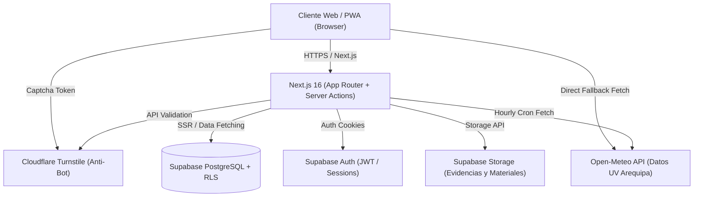

# Centro de Documentación · Plataforma RSU "Brigada Ambiental FEC"

Bienvenido a la documentación oficial y técnica de la plataforma web del proyecto de Responsabilidad Social Universitaria (RSU) **"Brigada Ambiental Universitaria – Facultad de Economía"** (UNSA, Semestre 2026-A).

Este sistema integra la prevención ante radiación solar extrema en Arequipa (D.S. N.° 003-2026-SA), control de aforo en tiempo real con transacciones atómicas, gestión operativa de brigadistas universitarios, repositorio de recursos educativos y exportación de datos científicos y administrativos protegidos contra inyecciones.

---

## 📚 Índice de la Documentación

| Documento | Descripción |
|---|---|
| [**Arquitectura del Sistema**](./arquitectura.md) | Visión global, stack tecnológico (Next.js 16, Supabase, Tailwind v4), estructura del proyecto y flujo de datos. |
| [**Modelo de Base de Datos**](./base-de-datos.md) | Diagrama ER, tablas, tipos enumerados, funciones en esquema `private`, triggers de aforo y migraciones SQL. |
| [**Seguridad y Row Level Security (RLS)**](./seguridad-y-rls.md) | Políticas RLS por tabla, RBAC (`coordinator`, `brigadista`, `anon`), protección de PII, sanitización anti-fórmulas Excel y Cloudflare Turnstile. |
| [**Módulos Funcionales**](./modulos.md) | Detalle de Landing/Monitor UV, Foro con aforo de 130, Portal de Brigada, Panel de Coordinación, Repositorio de Materiales y Perfil Docente. |
| [**APIs y Servicios**](./api-y-servicios.md) | Endpoints REST (`/api/uv`, `/api/reports/*`), Server Actions de Next.js, caché resiliente y cron de lecturas UV. |
| [**Guía de Desarrollo y Despliegue**](./guia-desarrollo-despliegue.md) | Requisitos, variables de entorno, configuración local, migraciones de base de datos y despliegue a producción. |
| [**Sistema de Diseño (Stripe Inspired)**](./desing.md) | Guía de estilos visuales, paleta de color guinda (`#8B004A`), elevaciones, tipografía y componentes. |
| [**Hipótesis y Directiva de Misión**](./hipotesis.md) | Hipótesis fundacional del proyecto y especificaciones iniciales de diseño y arquitectura. |

---

## 🎯 Objetivos y Contexto Institucional

1. **Prevención de Radiación Solar:** Difusión continua del índice UV en la ciudad de Arequipa en cumplimiento del **D.S. N.° 003-2026-SA**, con alertas y recomendaciones según los niveles de la OMS.
2. **Control de Aforo Sellado en BD:** Gestión de cupos para el **Foro Ambiental y de Salud 2026** (130 asientos estrictos) gestionados mediante bloqueos a nivel de fila (`pg_advisory_xact_lock`) en PostgreSQL.
3. **Gestión de Brigadistas:** Control operativo de las secciones A y B de la Facultad de Economía (90 brigadistas), facilitando el registro de turnos, asistencia y evidencias fotográficas.
4. **Datos Abiertos y Reportes:** Exportación de conjuntos de datos en formato Excel (.xlsx) sanitizados de fórmulas maliciosas para el análisis econométrico y auditoría RSU.

---

## 🚀 Resumen del Stack Tecnológico

- **Frontend:** Next.js 16 (App Router), React 19, TypeScript 5, Tailwind CSS v4, Motion (Framer Motion).
- **Backend / Persistencia:** Supabase (PostgreSQL 15+, Row Level Security, Auth con cookies SSR, Storage y Realtime).
- **Seguridad:** Cloudflare Turnstile, Advisory Locks de PostgreSQL, Sanitización RFC/OWASP contra inyección de fórmulas en `.xlsx`.
- **Integraciones:** API pública Open-Meteo para radiación ultravioleta en Arequipa.

---

> [!NOTE]
> Para empezar a trabajar localmente en el proyecto, consulte la [Guía de Desarrollo y Despliegue](./guia-desarrollo-despliegue.md).
