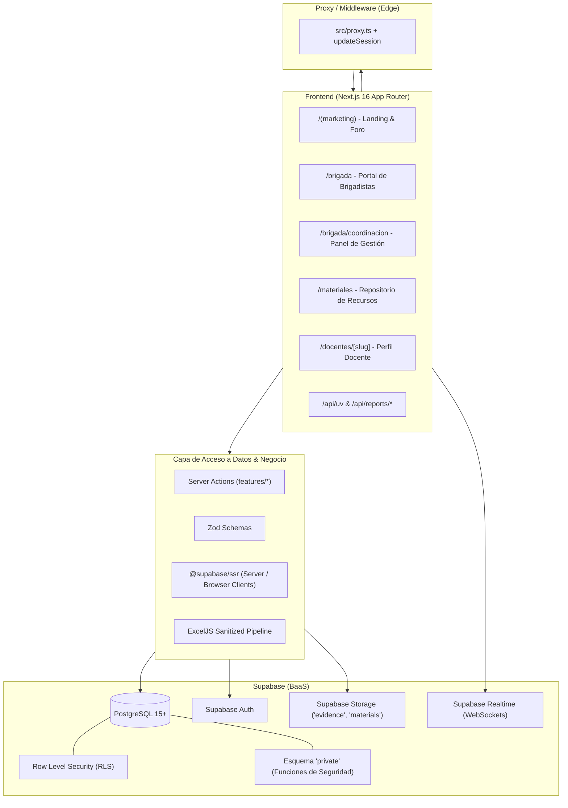

# Arquitectura del Sistema

Este documento describe la arquitectura global, patrones de diseño, estructura de directorios y flujo de datos de la plataforma **Brigada Ambiental FEC · RSU 2026-A**.

---

## 1. Visión General de la Arquitectura

La plataforma sigue una arquitectura moderna orientada a la nube (*Cloud-Native Serverless*), basada en **Next.js 16 (App Router)** y **Supabase** como backend relacional, combinando Server-Side Rendering (SSR), Server Components (RSC) y Server Actions con validación estricta en tipado de datos de extremo a extremo.



---

## 2. Capas del Sistema

### 2.1. Capa de Presentación (UI & Componentes)
- **Framework:** Next.js 16 con React 19.
- **Estilos:** Tailwind CSS v4 para diseño atómico y responsivo, complementado con variables CSS semánticas (tema Guinda `#8B004A`).
- **Animaciones:** `motion` (`framer-motion`) para transiciones fluidas de alto rendimiento y microinteracciones inspiradas en Stripe.
- **PWA (Progressive Web App):** Service Worker registrado en `src/components/pwa/sw-register.tsx`, manifiesto web dinámico en `src/app/manifest.ts` e iconos generados mediante ImageResponse en `src/app/icons/`.

### 2.2. Capa de Dominio y Negocio (`src/features/*`)
La lógica de negocio se organiza verticalmente por dominios funcionales:
- **`foro/`**: Esquemas de validación Zod (`schema.ts`), Server Actions para registro con Turnstile (`actions.ts`) y componentes como la barra de aforo (`aforo-bar.tsx`).
- **`brigada/`**: Acciones de autenticación, registro de evidencias fotográficas (`evidence-actions.ts`) y consultas de turnos y actividades (`queries.ts`).
- **`coordinacion/`**: Creación de actividades, control de asistencia, moderación de evidencias (`evidence-review-actions.ts`), métricas agregadas del panel y guards de autorización (`guard.ts`).
- **`materiales/`**: Gestión integral de documentos y recursos educativos (subida, publicación, descarga, generación de OpenGraph dinámico).

### 2.3. Capa de Servicios y Utilidades (`src/lib/*`)
- **`supabase/`**:
  - `client.ts`: Cliente de Supabase para Client Components (`createBrowserClient`).
  - `server.ts`: Cliente de Supabase para Server Components y Server Actions con lectura y escritura de cookies de sesión.
  - `middleware.ts`: Refresco de tokens de autenticación y redirección automática para rutas protegidas (`/brigada`).
  - `database.types.ts`: Tipos TypeScript generados para todas las tablas, tipos enum y funciones de Postgres.
- **`uv-server.ts` y `uv.ts`**: Lógica de consulta a la API de Open-Meteo, cálculo de niveles de riesgo OMS y fallback hacia la última lectura almacenada en BD.
- **`xlsx.ts`**: Utilidad con `ExcelJS` para compilar y generar archivos Excel `.xlsx` directamente en memoria, aplicando desinfección preventiva (`sanitizeCell`) contra inyección de fórmulas CSV.
- **`turnstile.ts`**: Validación server-side de tokens generados por el widget de Cloudflare Turnstile.

---

## 3. Estructura de Directorios

```
RSU-ECO-POLITICA/
├── docs/                     # Documentación técnica y funcional del proyecto
│   ├── README.md             # Índice central de la documentación
│   ├── arquitectura.md       # Arquitectura del sistema (este archivo)
│   ├── base-de-datos.md      # Esquema, tablas y funciones de Supabase
│   ├── seguridad-y-rls.md    # Políticas RLS y modelo de seguridad
│   ├── modulos.md            # Especificación de módulos funcionales
│   ├── api-y-servicios.md    # Endpoints REST y Server Actions
│   ├── guia-desarrollo-despliegue.md # Configuración local y despliegue
│   ├── desing.md             # Guía visual y componentes de diseño
│   └── hipotesis.md          # Directiva y alcance fundacional
├── public/                   # Recursos estáticos públicos (logos, imágenes)
├── src/
│   ├── app/                  # Rutas de Next.js (App Router)
│   │   ├── (auth)/           # Rutas públicas de autenticación (/login, /registro)
│   │   ├── (marketing)/      # Landing page pública (/) y foro (/foro)
│   │   ├── api/              # Endpoints API REST (/api/uv, /api/reports/*)
│   │   ├── brigada/          # Portal privado para brigadistas y coordinación
│   │   ├── docentes/         # Perfil público de docentes (/docentes/[slug])
│   │   ├── icons/            # Generadores dinámicos de iconos PWA
│   │   ├── globals.css       # Estilos globales y tokens de diseño
│   │   ├── layout.tsx        # Layout principal y envoltorio global
│   │   ├── manifest.ts       # Manifiesto PWA para instalación móvil
│   │   └── proxy.ts          # Middleware Edge para verificación de sesiones
│   ├── components/           # Componentes UI reutilizables
│   │   ├── pwa/              # Registro de Service Worker
│   │   ├── site/             # Header, Footer, UV Monitor, Mesh Backdrop
│   │   └── ui/               # Botones, Cards, Inputs, Badges, Turnstile
│   ├── data/                 # Datos estáticos (ej. perfil del docente Zuzunaga)
│   ├── features/             # Lógica de dominio modular (acciones, esquemas, UI)
│   │   ├── brigada/
│   │   ├── coordinacion/
│   │   ├── foro/
│   │   └── materiales/
│   └── lib/                  # Clientes Supabase, helpers UV, exportadores XLSX
└── supabase/
    └── migrations/           # Archivos SQL versionados de Supabase
```

---

## 4. Patrón de Sesión y Autenticación con SSR

Para garantizar que el renderizado en servidor reconozca inmediatamente la sesión del usuario, la plataforma utiliza `@supabase/ssr` con cookies HttpOnly sincronizadas:

1. **Proxy Middleware (`src/proxy.ts`):**
   Interviene en cada petición HTTP (excepto assets estáticos). Ejecuta `updateSession` para renovar la expiración del JWT en las cookies. Si un usuario no autenticado intenta acceder a `/brigada`, es redirigido a `/login?next=...`.
2. **Server Client (`src/lib/supabase/server.ts`):**
   Accede a las cookies de la petición entrante mediante la API `cookies()` de Next.js, permitiendo que los Server Components lean datos protegidos aplicando automáticamente las políticas RLS del usuario conectado.
3. **Control por Roles en Dos Fases:**
   - *Fase Rápida (Aplicación):* Helper `requireCoordinator` en `src/features/coordinacion/guard.ts` valida el rol antes de procesar operaciones de coordinación.
   - *Fase Inviolable (Base de Datos):* Las políticas de Row Level Security (RLS) en Postgres impiden cualquier lectura, inserción o modificación que no cumpla las funciones de comprobación en el esquema `private`.
