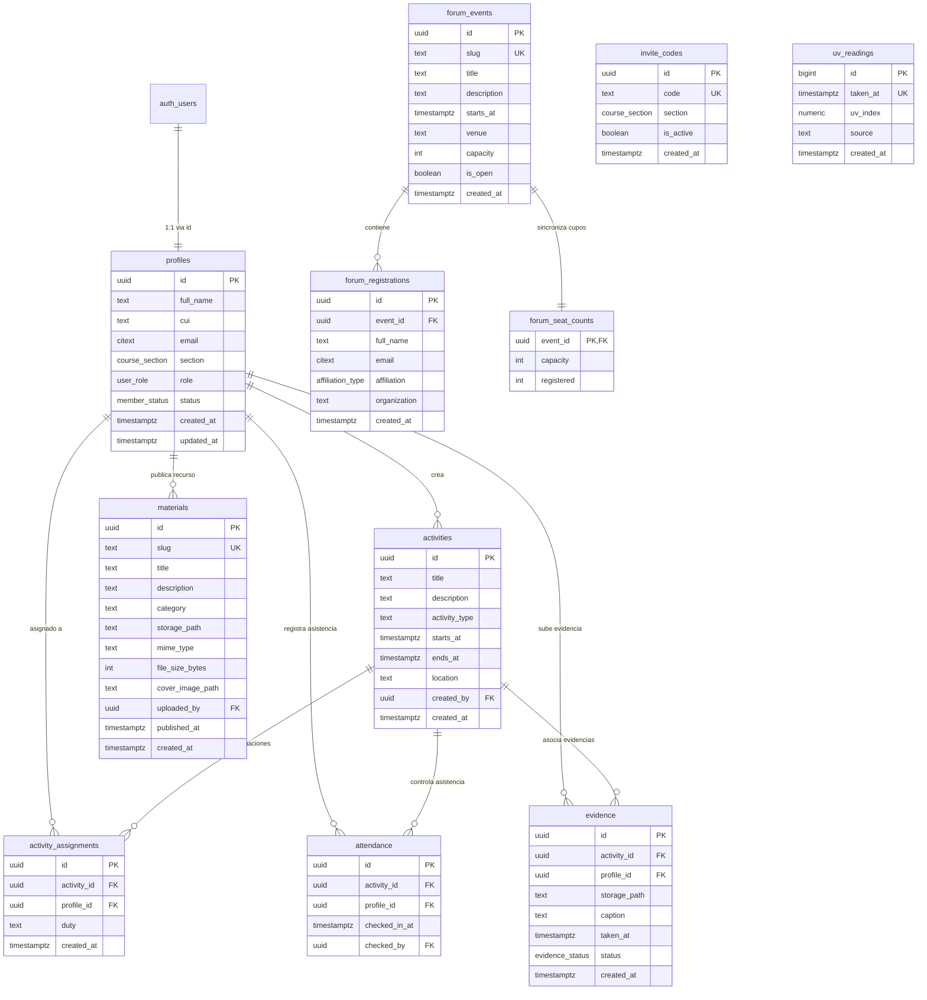

# Modelo de Base de Datos y Persistencia

Este documento describe la estructura relacional, tipos personalizados, esquemas de seguridad, funciones de base de datos y triggers implementados en **PostgreSQL** a través de **Supabase**.

---

## 1. Diagrama Entidad-Relación (ER)



---

## 2. Tipos Enumerados (Enums)

| Tipo | Valores | Propósito |
|---|---|---|
| `public.user_role` | `'coordinator'`, `'brigadista'` | Roles de usuario para control de acceso RBAC. |
| `public.member_status` | `'pending'`, `'active'`, `'rejected'` | Estado de admisión de los brigadistas. |
| `public.course_section` | `'A'`, `'B'` | Secciones académicas de la Facultad de Economía. |
| `public.affiliation_type` | `'interno'`, `'externo'` | Tipo de asistente registrado en el Foro. |
| `public.evidence_status` | `'pending'`, `'approved'`, `'rejected'` | Flujo de aprobación para evidencias subidas. |

---

## 3. Esquemas y Organización de Seguridad

La base de datos separa deliberadamente la API pública del esquema interno:
- **`public`**: Contiene las tablas de negocio accesibles a través de la Data API (PostgREST), estrictamente gobernadas por Row Level Security.
- **`private`**: Esquema inaccesible desde la API REST/PostgREST. Almacena funciones críticas con privilegio `SECURITY DEFINER` y un `search_path = ''` explícito para evitar ataques de inyección de esquemas.
- **`storage`**: Esquema nativo de Supabase para la administración de buckets y objetos binarios.

---

## 4. Descripción Detallada de Tablas

### 4.1. `public.profiles`
Espejo extendido de `auth.users`. Guarda los datos académicos y estado de los brigadistas y coordinadores.
- `id` (UUID, PK): Clave foránea hacia `auth.users(id)` con eliminación en cascada.
- `cui` (TEXT): Código Único de Identificación estudiantil (UNSA).
- `email` (`extensions.citext`): Correo electrónico insensible a mayúsculas.
- `section` (`course_section`): Sección a la que pertenece el brigadista (A o B).
- `role` (`user_role`): Rol asignado (por defecto `'brigadista'`).
- `status` (`member_status`): Estado de membresía (por defecto `'pending'`).

### 4.2. `public.invite_codes`
Códigos de invitación para que los estudiantes se registren en su respectiva sección.
- `code` (TEXT, UNIQUE): Código alfa-numérico (ej. `BRIGADA-A-2026`).
- `section` (`course_section`): Sección asociada al código.
- `is_active` (BOOLEAN): Bandera para deshabilitar códigos expirados.

### 4.3. `public.forum_events` y `public.forum_registrations`
Gestión de eventos académicos con límite estricto de cupos.
- `forum_events`: Almacena el evento (slug `foro-ambiental-2026`), capacidad (130 asientos) y estado de apertura (`is_open`).
- `forum_registrations`: Almacena las inscripciones personales. Tiene una restricción única `(event_id, email)` que previene duplicados.

### 4.4. `public.forum_seat_counts`
Tabla pública desprovista de información personal (PII) que expone únicamente el total de inscritos y la capacidad máxima. Esto permite que cualquier usuario anónimo consulte el aforo en tiempo real sin violar la privacidad de los asistentes registrados.

### 4.5. `public.uv_readings`
Registro histórico de radiación UV en Arequipa para series temporales e investigación econométrica:
- `taken_at` (TIMESTAMPTZ, UNIQUE): Hora de la medición.
- `uv_index` (NUMERIC(4,2)): Valor medido (ej. 14.50).
- `source` (TEXT): Proveedor de origen (ej. `'open-meteo'`).

### 4.6. `public.activities`, `activity_assignments` y `attendance`
Operaciones de campo para brigadistas:
- `activities`: Registro de turnos y actividades programadas (lugar, horario, creador).
- `activity_assignments`: Brigadistas asignados a cada turno con función asignada (`duty`).
- `attendance`: Registro de marcación de asistencia con fecha, hora y usuario que la validó (`checked_by`).

### 4.7. `public.evidence`
Bitácora de evidencias fotográficas de brigadistas:
- `storage_path`: Ruta del archivo dentro del bucket privado `evidence`.
- `status`: Estado de validación por parte del coordinador (`pending`, `approved`, `rejected`).

### 4.8. `public.materials`
Repositorio de recursos educativos y normativos:
- `slug` (TEXT, UNIQUE): Identificador amigable en la URL (`/materiales/[slug]`).
- `storage_path`: Ruta del archivo en el bucket `materials`.
- `cover_image_path`: Imagen de portada o miniatura para redes sociales.
- `file_size_bytes` y `mime_type`: Metadatos técnicos para optimizar la visualización y descarga.

---

## 5. Triggers y Funciones de Seguridad en el Esquema `private`

### 5.1. Control Atómico de Aforo (`private.enforce_forum_capacity`)
Para prevenir condiciones de carrera (*race conditions*) cuando múltiples usuarios intentan inscribirse simultáneamente al último cupo disponible, se implementó un bloqueo transaccional:
```sql
perform pg_advisory_xact_lock(hashtext(new.event_id::text));
```
El bloqueo se libera automáticamente al terminar la transacción. Si el aforo de 130 se superó, Postgres lanza una excepción con el código `'AFORO_COMPLETO'`, cancelando el insert.

### 5.2. Sincronización Automática de Asientos (`private.sync_seat_counts`)
Tras cada inserción o eliminación en `forum_registrations`, este trigger actualiza atómicamente la tabla `forum_seat_counts`.

### 5.3. Protección de Columnas Críticas (`private.protect_profile_columns`)
Impide que los usuarios comunes puedan escalar privilegios modificando su propio `role`, `status` o `email` en `profiles`. Solo la función `private.is_coordinator()` tiene permiso para efectuar dichos cambios.

---

## 6. Buckets de Almacenamiento (Supabase Storage)

1. **`evidence` (Privado):**
   - Límite de tamaño: 10 MB por archivo.
   - Tipos MIME permitidos: `image/jpeg`, `image/png`, `image/webp`.
   - Acceso: Los brigadistas suben sus archivos; solo el brigadista autor y los coordinadores pueden verlos.
2. **`materials` (Público para lectura):**
   - Límite de tamaño: 25 MB por archivo.
   - Tipos MIME permitidos: PDF, PNG, JPG, WEBP, DOCX, PPTX, XLSX.
   - Acceso: Lectura pública; creación, modificación y eliminación reservada exclusivamente para el coordinador.
